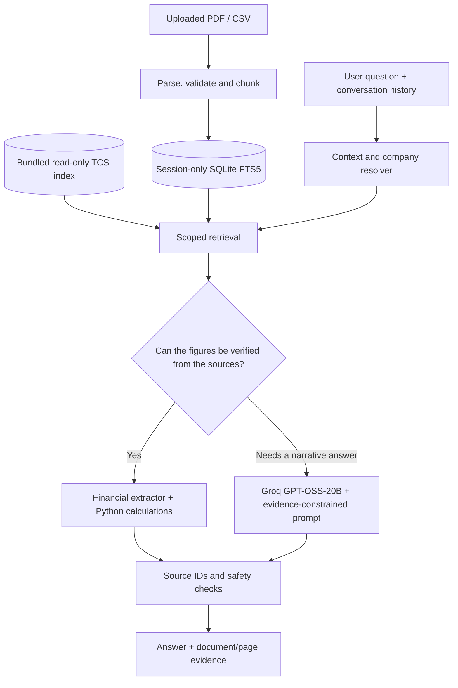

# 📊 ReportLens AI

### Ask questions about business reports. Get answers you can trace back to the source.

**Status:** Deployed · GitHub Actions passing · 111 local tests passed  
**Live demo:** [Open ReportLens AI](https://reportlens-ai-9dm9d9d3tt6fqqfwsaqcob.streamlit.app/)

> **Built for the Humanli.ai Machine Learning / GenAI Engineer technical assessment — Assignment 3: Multi-Document RAG System with Chat History and Conversational Memory.**

## What is ReportLens AI?

A company annual report can be hundreds of pages long. If you want to know *how revenue changed*, *why a business segment grew*, or *how two companies compare*, finding the figures and checking the right reporting period takes time.

**ReportLens AI lets you ask those questions in plain English.** It finds relevant passages in uploaded PDF reports or CSV files, creates an answer from the available evidence, and shows which document and page supplied the information.

It also remembers the *topic* of a conversation. You can ask:

> **You:** What was Infosys's revenue in FY 2024–25?  
> **ReportLens:** ₹1,62,990 crore. [Source: uploaded Infosys annual report]  
> **You:** How much did it increase in FY 2025–26, in crore and percentage?  
> **ReportLens:** ₹15,660 crore, or **9.61%**, using FY 2025–26 revenue of ₹1,78,650 crore and the previous figure.

The second question does not repeat “Infosys” or “revenue.” The app resolves both from the preceding turn, then **retrieves the supporting financial figures again** rather than trusting an earlier AI answer.

## Try it in under a minute

1. Open the **[live application](https://reportlens-ai-9dm9d9d3tt6fqqfwsaqcob.streamlit.app/)**. Four TCS annual reports are already searchable—no upload required.
2. Ask: **“Show TCS consolidated revenue from FY 2022–23 to FY 2025–26.”**
3. Expand **Evidence and citations** to inspect source documents and PDF pages.
4. Optionally upload your own PDF or CSV, select a company or search scope, and ask follow-up questions.

**Example questions:**

```text
Compare TCS and Infosys consolidated revenue for FY 2025–26.
What were the main risks mentioned in the TCS FY 2024–25 report?
Which financial year had the highest revenue?
What was Infosys revenue in FY 2024–25?
How much did it increase the following year, in ₹ crore and percentage?
```

*The Infosys examples require you to upload the relevant Infosys reports; only the four TCS reports are bundled.*

## What it can do

| Feature | What it means for a user |
|---|---|
| **Ask across multiple documents** | Search four preloaded TCS annual reports plus up to five session-uploaded PDFs/CSVs. |
| **Compare companies and years** | Keep TCS and Infosys figures separate; include the matching document and fiscal period. |
| **Understand follow-ups** | Interpret “How much did it increase?” using recent conversation context. |
| **Work with financial tables** | Extract supported revenue, profit and expense figures and calculate absolute/percentage changes. |
| **Show evidence** | Display source IDs, filenames, PDF-page locations and retrieved excerpts. |
| **Ask for clarification** | If multiple companies are present and the question is ambiguous, request a company instead of mixing figures. |
| **Manage files** | Upload, index, remove, filter and clear private documents without changing the reference reports. |
| **Admit uncertainty** | Withhold unsupported figures, reject unresolved source IDs and decline answers with insufficient evidence. |

## How it works

ReportLens AI uses **retrieval-augmented generation (RAG)**: retrieve information from documents *before* asking a language model to write an answer. The current fast implementation combines **SQLite FTS5 lexical search**, source-grounded financial extraction and a Groq-hosted open-weight language model.



**The main components:**

- **Ingestion:** PyMuPDF extracts PDF page text; pandas handles CSV data. PDF/table validation rejects files that cannot be safely processed.
- **Indexing:** Text becomes searchable chunks with document identity and page provenance. Permanent TCS data is stored in a bundled, read-only SQLite database; uploads use a separate in-memory SQLite database per Streamlit session.
- **Retrieval:** SQLite FTS5 searches candidate passages; company, document and financial-year constraints narrow the scope. Financial-statement passages receive special handling.
- **Conversation:** A lightweight resolver rewrites referential follow-ups into standalone questions. Chat messages provide **intent**, not evidence.
- **Generation:** Supported financial calculations use extracted source values and deterministic arithmetic. Other questions use `openai/gpt-oss-20b` through Groq with an evidence-only prompt.
- **Verification:** Source IDs must resolve to retrieved evidence; ambiguous reporting years, unsupported values and incomplete citations are handled conservatively.

### One example of grounded numerical reasoning

| Infosys financial year | Consolidated revenue from operations |
|---|---:|
| FY 2024–25 | ₹1,62,990 crore |
| FY 2025–26 | ₹1,78,650 crore |
| **Increase** | **₹15,660 crore** |
| **Growth** | **9.61%** |

`(178650 - 162990) / 162990 × 100 = 9.61%`

These are the values verified in the deployed app with two uploaded Infosys annual reports. The app traces each underlying revenue value to its selected source; the percentage is **calculated**, not presented as a separately reported number.

## Engineering decisions and trade-offs

This is the part of the project I consider most important: **a RAG system should be designed around its actual workload and constraints, not around the number of frameworks it uses.**

| Decision | Why I made it | Trade-off / next step |
|---|---|---|
| **SQLite FTS5 instead of dense vectors in the deployed path** | Financial reports contain exact entities, year labels and numeric rows; FTS5 avoids loading an embedding model and keeps startup and memory costs low on free hosting. | Lexical search can miss semantic paraphrases. A hybrid FTS5 + embeddings retriever is a future improvement. |
| **Pre-index four reference reports** | Users can try the product immediately; no repeated parsing of hundreds of pages during every cloud restart. | The bundled index is a fixed reference snapshot and must be rebuilt when source reports change. |
| **Keep user uploads session-local** | Avoid mixing one user's files with the global TCS data or another user's search results. | Uploads and chat history are intentionally temporary rather than account-persistent. |
| **Prefer deterministic calculations for financial answers** | LLMs can confuse currencies, columns, fiscal periods and consolidated versus standalone figures. Source-first extraction plus Python arithmetic is more controllable. | Unusual PDF table layouts may require more robust parsing or a cautious refusal. |
| **Resolve context before retrieval** | “How much did it increase?” needs the previous company's name, metric and period; searching those words alone is unreliable. | Resolution is conservative and focused on supported follow-up patterns, not unrestricted long-term memory. |
| **Use lightweight Python orchestration** | The pipeline has a predictable retrieve → verify/calculate or generate → cite flow. Extra agent frameworks would add complexity without a clear benefit for this assignment. | LangGraph/CrewAI-style workflows may make sense for future multi-step tool-using agents; they are **not** claimed as part of this implementation. |
| **Use Groq-hosted GPT-OSS instead of self-hosting/fine-tuning** | A configurable open-weight model provides inference without GPU hosting and maintenance, while retrieval keeps changing document facts external to the weights. | External inference requires a provider key and sends selected evidence to that provider. No model fine-tuning was performed. |
| **Require source IDs in generated answers** | A response must point back to retrievable passages rather than merely sound convincing. | Structural citation validity does **not** prove every claim is semantically supported; claim-level verification remains a future improvement. |

### What this implementation demonstrates for the Humanli.ai role

| Engineering area from the GenAI/ML role | Evidence in this repository |
|---|---|
| **GenAI application design** | End-to-end PDF/CSV ingestion, indexing, retrieval, grounded response generation and cloud deployment. |
| **Prompt engineering and LLM integration** | Evidence-only system prompt, source-ID requirements, missing-evidence behavior and configurable Groq model. |
| **Conversational memory** | Intent-aware follow-up rewriting, company selection and fresh retrieval on every factual turn. |
| **Information retrieval and data processing** | SQLite FTS5 search, document/year filters, chunk metadata and financial-table parsing. |
| **LLMOps / evaluation** | Fixed 35-question ground truth, deterministic checks, RAGAS judging, checkpointed evaluations and regression tests. |
| **Software engineering and CI/CD** | Modular Python code, pytest suite, GitHub Actions and live Streamlit Cloud deployment. |
| **Engineering judgment** | Explicit latency, accuracy, simplicity, hosting-cost and privacy trade-offs instead of unsupported framework claims. |

**Scope clarity:** This project demonstrates a deployed **GenAI/RAG application**. It does not claim to implement LangChain/LangGraph/CrewAI orchestration, a FastAPI service, GPU self-hosting, CNN/RNN training or LLM fine-tuning; those are separate skills and architectural choices.

## Evaluation and testing

I evaluated the application using a fixed **35-question TCS benchmark**, covering factual questions (8), numerical questions (5), comparisons (7), analysis (8), summaries (2) and unanswerable questions (5). The original dataset is versioned in `evaluation/ground_truth/`.

| Observed check | Result | What it measures |
|---|---:|---|
| Full application evaluation run | **35/35** processed | All questions generated and saved in the evaluated run. |
| Expected-source-document retrieval | **30/30 (100%)** | Correct report appeared among the top 9 retrieved passages; **not** page-level correctness. |
| Reference-number coverage after fixes | **100%** on applicable cases | Expected numeric values present in answers; **not** an overall factual-accuracy score. |
| Unanswerable-question abstention | **5/5 (100%)** | Correctly declined questions without enough source evidence. |
| **RAGAS factual correctness** | **0.433 mean (27 scored cases)** | Claim-level comparison with contextualized references. |
| **RAGAS faithfulness** | **0.880 mean (18 scored cases)** | Support from a reduced retrieved-evidence window. |
| Latest local automated suite | **111 tests passed** | Unit and integration checks on the local Windows environment. |
| GitHub Actions | **Passing** | Offline tests execute on repository pushes. |
| Phase 8 backend verification | **14/14 checks passed** | Ingestion, retrieval, filtering, session database separation, removal and more. |

**Interpretation:** RAGAS was run as a separate judge-based evaluation using `qwen/qwen3.8-27b`. The reported averages are for **valid scored cases** (27 and 18 respectively), not extrapolated scores for all 30 answerable cases. Numerical matching, retrieval coverage and RAGAS assess different properties; none alone guarantees claim-by-claim citation correctness. See `docs/EVALUATION.md` for the evaluation methodology.

**Local retrieval performance:** Across 16 benchmark retrieval requests on Windows, SQLite search had **p50 = 33.582 ms** and **p95 = 38.745 ms**. These measurements exclude Groq inference and browser rendering and are not production latency guarantees.

```bash
# Offline tests and deployment checks
python -m pip install -r requirements-dev.txt
python -m pytest -q
python -m scripts.phase8_verify
python -m scripts.phase9_preflight

# Run the reproducible offline retrieval evaluation
python -m evaluation.evaluate --mode retrieval
```

## Run locally

**Requirements:** Python 3.13 recommended, a Groq API key for LLM-generated answers. The prebuilt reference index is included, so you don't need the original TCS PDFs to start.

Get the HTTPS clone URL from the project repository using **Code → HTTPS**, then substitute it for `REPOSITORY_CLONE_URL` in the commands below.

**Windows (PowerShell):**

```powershell
git clone REPOSITORY_CLONE_URL
cd reportlens-ai
python -m venv .venv
.\.venv\Scripts\Activate.ps1
python -m pip install -r requirements.txt
```

**macOS / Linux:**

```bash
git clone REPOSITORY_CLONE_URL
cd reportlens-ai
python3 -m venv .venv
source .venv/bin/activate
python -m pip install -r requirements.txt
```

Copy `.env.example` to `.env` and set:

```dotenv
GROQ_API_KEY=your_groq_key_here
GROQ_MODEL=openai/gpt-oss-20b
```

Then:

```bash
python -m scripts.phase9_preflight
streamlit run app.py
```

Open `localhost:8501` in your browser. The sidebar should show **Permanent reports (4/4)**.

## Project structure

```text
reportlens-ai/
├── app.py                          # Streamlit UI, uploads, chat and filters
├── src/
│   ├── fast_rag.py                 # SQLite FTS5, chunking, retrieval and generation
│   ├── conversation_context.py     # Follow-up interpretation
│   ├── document_routing.py         # Company/document scoping
│   ├── financial_summary.py        # Financial statement extraction
│   ├── verified_financial.py       # Source-based financial comparisons
│   ├── response_safety.py          # Citation ID and error-message safeguards
│   └── upload_policy.py            # File limits and preflight validation
├── data/index/
│   └── reference_reports.sqlite3   # Bundled TCS search index
├── evaluation/
│   ├── ground_truth/               # Original 35-question dataset
│   ├── evaluate.py                 # Retrieval and answer-level evaluation
│   └── ragas_eval.py               # RAGAS judge integration
├── scripts/                        # Index build, smoke tests and preflights
├── tests/                          # Unit/integration/regression tests
├── docs/                           # Design, evaluation and deployment notes
├── .github/workflows/tests.yml     # Offline CI pipeline
├── .streamlit/config.toml          # Streamlit settings
├── requirements.txt                # Runtime packages
├── requirements-dev.txt            # Test packages
└── requirements-eval.txt           # Optional evaluation packages
```

**Reference index:** 4 TCS reports · **1,382 pages** · **3,096 searchable chunks** · **~8.92 MiB**. Uploaded reports are never inserted into this bundled index.

## Deployment, privacy and constraints

**Live app:** [Open ReportLens AI](https://reportlens-ai-9dm9d9d3tt6fqqfwsaqcob.streamlit.app/)  
**Source and CI:** Available in the project repository (no additional external links included here).

The deployment uses `app.py`, `requirements.txt`, the bundled index and a `GROQ_API_KEY` configured under **Streamlit Cloud Secrets** (never in Git). See `docs/DEPLOYMENT.md`.

| Upload policy | Limit |
|---|---|
| Types | PDF and CSV |
| Files per session | 5 |
| PDF size / length | 20 MiB / 500 pages |
| CSV size / rows | 10 MiB / 30,000 data rows |
| Total uploaded size | 50 MiB |

**Privacy:** Uploads and conversation history are temporary, session-specific app data; they are not written to the permanent reference index. Selected retrieved passages may be sent to Groq for inference. Do not submit sensitive documents unless this external processing is appropriate.

**Known limitations and roadmap:**

- Lexical-only retrieval can miss paraphrases → evaluate **hybrid lexical + dense semantic search**.
- Scanned/image-only PDFs are unsupported → add **OCR**.
- Complex table layouts can be ambiguous → improve **table structure recognition and cross-statement validation**.
- Citation IDs identify retrieved evidence, but do not prove every claim → add **claim-level source entailment checks**.
- Uploads are intentionally temporary; concurrent-browser load testing and persistent organization workspaces remain future work.

**Data rights:** Original report PDFs and private uploads are excluded from Git. The bundled SQLite index still contains text extracted from published reports; review redistribution rights for that content before republishing it. No separate code license is asserted by this README.

---

**ReportLens AI** · A practical, source-grounded approach to multi-document conversational RAG.  
[Try the live app](https://reportlens-ai-9dm9d9d3tt6fqqfwsaqcob.streamlit.app/)
